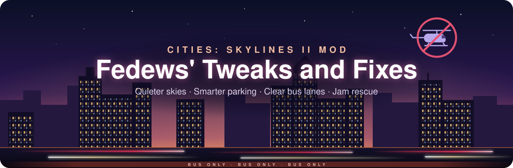

<div align="center">



<br>

[](https://www.paradoxinteractive.com/games/cities-skylines-ii)
[](#installation)
[](LICENSE)

Per-sound volume control, traffic fixes and city service fixes. Every feature is optional, under **Options → Fedews' Tweaks and Fixes**.

</div>

## Features

### 🔊 Volume per sound type
Ten sliders: helicopters, space rocket, airplanes, road traffic, sirens & horns, trains, ships, buildings, people & animals, and everything else (nature, wind).

- Sounds are grouped by **what's making them**, not by file name. Changes apply instantly.
- All sliders start at 100%, so nothing changes until you move one.
- A sound shared by two groups (e.g. a bus and a tram engine) follows the **lower** of the two sliders.
- **Write sound list to log** shows which group every sound is in.

### 🅿️ Parking spot reservations
In the base game, when a spot frees up, every nearby car heads for it, and the losers U-turn and re-route over and over. With this on, a spot that a car is already heading to counts as **taken** for every other route, whether it's on the street, in a parking lot or in a parking garage. Cars are never removed or teleported.

### 🚌 Strict bus lanes
In the base game, bus lanes only carry a small penalty, so cars dive in to skip queues. This multiplies that penalty (**25×** by default, 5–100×) for cars and trucks that aren't allowed in bus lanes. It's not a hard ban, because some turns and driveways can only be reached through a bus lane. Buses, taxis and emergency vehicles are unaffected.

- It changes **which roads** drivers take, never **whether** people drive. People still choose between their car, a taxi, transit and walking exactly as in the base game.
- A private car whose route goes through a bus lane plans it once more before it leaves its parking spot, this time with the penalty, and waits there for the new route. Park-and-ride trips keep their original plan. Cars that are already driving are never sent a new route, so they don't turn around mid-street.

### ⚱️ Crematoriums empty cemeteries
In the base game, a full cemetery stays full forever: nothing takes the bodies out, and there's no "Empty" button like landfills have. With this on, a crematorium that has finished the bodies from the city takes the next ones from the fullest cemetery and cremates them at its normal speed. City bodies always come first, and crematoriums keep room for incoming hearses. No hearses drive between the two; the bodies move straight over.

### 🗑️ Landfills stop emptying when empty
In the base game, a landfill set to "Empty" stays out of service forever, even after it's empty: its trucks stay parked and it takes no garbage. Now the button switches itself off once the landfill is empty.

### 🚑 Faster service calls
In the base game, every time a building calls for a garbage truck, hearse, ambulance, fire truck or police and none is free, it waits twice as long before calling again, up to about 6 in-game hours. So after one busy moment, garbage and bodies pile up and fires burn for hours while vehicles sit idle. Now the wait is capped at about 20 in-game minutes. Patrols, mail and road maintenance are unchanged.

### 🚨 Jam rescue

| Button | What it does |
| :-- | :-- |
| **Remove stuck traffic** | Watches traffic for 40 in-game seconds (10–180 s), then removes only vehicles that moved less than 10 m. Unpauses the game if needed and shows progress in the 🔔 notifications. |
| **Remove ALL moving traffic** | Emergency reset: instantly removes every driving car, taxi and delivery truck. Asks for confirmation first. |

> [!IMPORTANT]
> **Parked cars are never removed.** Neither are buses, trams, trains, emergency or service vehicles. Passengers of removed cars arrive straight at their destination (or home). Trucks lose their cargo, and businesses re-order.

<a id="installation"></a>

## Installation

1. Download `FedewsTweaks.zip` from the [latest release](../../releases/latest).
2. Extract it into `%USERPROFILE%\AppData\LocalLow\Colossal Order\Cities Skylines II\Mods\FedewsTweaks\`.
3. Start the game and open **Options → Fedews' Tweaks and Fixes**.

The mod adds nothing new to your saves, so you can add or remove it at any time.

<details>
<summary><b>Build from source</b></summary>
<br>

Requires the [.NET SDK](https://dotnet.microsoft.com/download) 8+ and the game installed. The build copies the mod straight into the game's `Mods` folder.

```powershell
dotnet build -c Release                                          # game in the default Steam folder
dotnet build -c Release -p:GameDir="X:\Path\Cities Skylines II"  # game installed elsewhere
```

You can also set `GameDir` once in a git-ignored `local.props` next to the project.

</details>

## Bugs & feedback

Use the [issue forms](../../issues/new/choose) and attach your log:
`%USERPROFILE%\AppData\LocalLow\Colossal Order\Cities Skylines II\Logs\FedewsTweaks.Mod.log`

A big game update can break code mods. If that happens, switch the affected option off until it's fixed. See the [changelog](CHANGELOG.md) for what's new.

---

<sub>MIT License · Uses <a href="https://github.com/pardeike/Harmony">Harmony</a> (MIT) · Cities: Skylines II is a trademark of Paradox Interactive AB. This unofficial mod is not affiliated with or endorsed by Colossal Order or Paradox Interactive.</sub>
